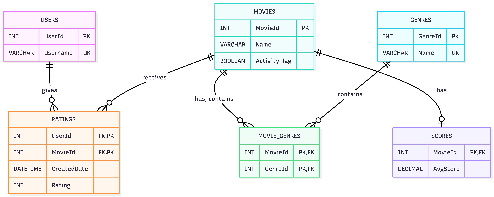

# ex603-movieTV-database

Colby Saxton

This is a Database for ex603 class for Movies/TV Shows.

This is a platform for a user to go into and create ratings for movies and view the aggregate scores for movies based on all ratings for that particular movie. This will also show a user the genre of a movie.

This will do that by creating a database schema with 5 different objects. First is a user which contains information about a user. Second is a movie. Third is a genre. Fourth is a movie genre connecting object. Fifth is a ratings object that allows a user to create a rating for a movie. See the ERD diagram below:



## Video Presentation

Watch the video presentation here: [Loom video](https://www.loom.com/share/454ecb107f7c4e4fbc8d99666cceb913)

## Database Schema

This document describes the Schema Design for a Movie/TV user score management application.

## Tables

### `users`

Stores core user account credentials.

### `movies`

Stores information about movies.

### `genres`

Stores movie genres.

### `scores`

Stores an average score for a movie. Its primary key allows at most one score row per movie.

### `movie_genres`

Sotres the relationship between movies and genres. The composite primary key `pk_movie_genre` uses (`movie_id`, `genre_id`), preventing duplicate links between the same movie and genre.

### `ratings`

Stores individual user ratings for movies.

## Relationships

- A user can have many ratings; each rating references one user. Deleting a user cascades to their ratings.
- A movie can have many ratings; each rating references one movie. Deleting a movie cascades to its ratings.
- Movies and genres have a many-to-many relationship through `movie_genres`. Deleting a movie or genre removes the corresponding link rows.
- A movie can have at most one `scores` row because `scores.movie_id` is its primary key. Deleting the movie cascades to its score row.

## Query Catalogue

The SQL files in [`queries/`](queries/) explore ratings, movie performance, and data-quality questions.

### [`q3_1.sql`](queries/q3_1.sql)

This file contains several introductory queries:

- **Top-rated movies:** joins ratings to movies, calculates each movie's average score, and returns the ten highest averages.  
  **Business question:** Which movies have the highest average user ratings?
- **Rating statuses:** lists the distinct `rating_status` values.  
  **Business question:** What statuses can a rating have?
- **Rating filters:** returns ratings with more than 10 watch minutes, then separately returns ratings from the US or UK.  
  **Business question:** Which ratings meet these engagement and region criteria?
- **Movie title search and missing inviter values:** finds titles containing `0` and displays users with a missing `invited_by` value as `-1`.  
  **Business question:** Which titles match this search pattern, and which users have no recorded inviter?
- **Calculated columns:** assigns each movie a release-era label and converts rating scores from a 0–5 scale to a 0–100 scale.  
  **Business question:** How can movies be grouped by release era, and how do ratings compare on a 100-point scale?

### [`q3_2.sql`](queries/q3_2.sql)

- **NULL-aware country filtering:** demonstrates why `device_country != 'US'` excludes rows with a NULL country, then uses `IS NULL OR device_country != 'US'` to include them. It also shows that a SELECT alias cannot be used in the same query's `WHERE` clause and demonstrates expression and CTE alternatives.  
  **Business question:** Which ratings are from outside the US or have no recorded country, and how can country values be filtered while treating missing values as “Unknown”?

### [`q3_3.sql`](queries/q3_3.sql)

- **Users with missing rating-country data:** finds users who have a rating with a NULL `device_country`, using a subquery and two CTE-based approaches.  
  **Business question:** Which users are associated with ratings whose region was not recorded?

### [`unit4/q4_1.sql`](queries/unit4/q4_1.sql)

- **Overall rating summary:** calculates minimum, maximum, count, and sum of scores, plus the number of distinct users who rated movies.  
  **Business question:** What is the overall volume and score range of rating activity?
- **Per-movie performance:** calculates each movie's rating count and average score, ordered by rating count. A second version limits results to movies with more than nine ratings.  
  **Business question:** How much rating activity and what average score does each movie have, and which movies have enough ratings to meet the selected threshold?
- **Per-movie, per-region performance:** calculates rating counts and average scores for each movie and device country.  
  **Business question:** How do movie ratings and rating volume vary by region?

### [`unit4/q4_2.sql`](queries/unit4/q4_2.sql)

- **Per-movie failures:** counts all ratings and counts ratings whose status is not `published`.  
  **Business question:** How many rating events and non-published events does each movie have?
- **Regional totals:** uses `ROLLUP` to show rating counts by device country, including a platform-wide grand total.  
  **Business question:** How many ratings come from each region, and how many ratings are there overall?
- **Above-average rating volume:** compares each movie's rating count with the average count per movie and returns movies above that average.  
  **Business question:** Which movies attract more rating activity than the typical movie?

### [`unit5/q5_1.sql`](queries/unit5/q5_1.sql)

- **Rating activity with user and movie names:** joins `ratings` to `users` and `movies` to show who rated which movie and when.  
  **Business question:** When did each user rate each movie?
- **Movies with their genres:** joins `movies` through `movie_genres` to `genres`, grouped by title and genre.  
  **Business question:** Which genres does each movie belong to?
- **Same-genre movie comparison:** uses a CTE of per-movie rating counts and average scores, then self-joins `movies` on a shared genre to pair movies against one another.  
  **Business question:** How does a movie's rating volume and average score compare with other movies in the same genre?

### [`unit5/q5_2.sql`](queries/unit5/q5_2.sql)

- **Join type comparison:** runs `LEFT`, `INNER`, `RIGHT`, and `FULL OUTER` joins between `movies` and `ratings` and notes how the row counts differ (for example 204 vs 206 rows between the inner and left joins).  
  **Business question:** Which movies or ratings are lost or revealed depending on the join type used?
- **Exclusion queries:** finds movies with no ratings using both `NOT EXISTS` and `EXCEPT`, and compares the two approaches.  
  **Business question:** Which movies have never been rated?

### [`unit5/q5_3.sql`](queries/unit5/q5_3.sql)

- **Cartesian product:** cross joins `ratings` and `users` (204 × 30 = 6,120 rows) to show how row counts multiply and when that is useful or a mistake.  
  **Business question:** What does an unconstrained join produce, and when would it be appropriate?
- **Join algorithm inspection:** runs `EXPLAIN` on the ratings/users/movies join and documents why PostgreSQL chose a hash join and nested loop.  
  **Business question:** How does the planner execute this join, and how might that change as data grows?

### [`unit6/q6_1.sql`](queries/unit6/q6_1.sql)

- **Window average vs. `GROUP BY`:** shows each rating next to its movie's average score using `AVG(...) OVER (PARTITION BY movie_id)`, contrasted with a plain `GROUP BY` that collapses the rows.  
  **Business question:** Is an individual rating unusually high or low compared with the movie's average?
- **Ranking functions:** compares `ROW_NUMBER`, `RANK`, and `DENSE_RANK` over movies ordered by rating count.  
  **Business question:** How do movies rank by rating activity, and how do the ranking functions treat ties?

### [`unit6/q6_3.sql`](queries/unit6/q6_3.sql)

- **Top three movies per genre:** uses a CTE with `RANK() OVER (PARTITION BY genre ...)` and `FIRST_VALUE` to find each genre's best-scoring movies.  
  **Business question:** Which movies are the top performers within each genre?
- **Month-over-month trends:** aggregates ratings by month, then uses `LAG` to compute percent change in average score and watch minutes, plus monthly failure counts and rates.  
  **Business question:** How are rating quality, engagement, and failure rates changing from month to month?

### [`movies.sql`](queries/movies.sql)

This is the reference dataset setup script rather than an analytical query: it recreates the database tables and loads the deterministic movie/TV dataset.  

## Technical Highlights

1. **Conditional aggregation** ([`q4_2.sql`](queries/unit4/q4_2.sql)) — `COUNT(*)` alongside a count of rows where `rating_status <> 'published'` gives total and failed ratings per movie in a single pass. Two separate filtered queries would scan the table twice; one pass is cheaper as data grows and keeps the numbers consistent in one result.
2. **`ROLLUP` subtotals** ([`q4_2.sql`](queries/unit4/q4_2.sql)) — rating counts by region plus a platform-wide grand total in one query. This is useful for regional reporting because the total row shows what the per-region rows can't, including ratings with no recorded country.
3. **CTE feeding a self-join** ([`q5_1.sql`](queries/unit5/q5_1.sql)) — a `movie_activity` CTE computes each movie's rating count and average once, and a self-join on `movie_genres` pairs movies sharing a genre. The CTE keeps the join readable and avoids repeating the aggregation for both sides of the comparison.
4. **Anti-join with `NOT EXISTS`** ([`q5_2.sql`](queries/unit5/q5_2.sql)) — finds movies that have no ratings. An inner join silently drops these rows, so the exclusion query surfaced the two unrated movies. `NOT EXISTS` is also NULL-safe and flexible with subqueries.
5. **Window functions** ([`q6_1.sql`](queries/unit6/q6_1.sql), [`q6_3.sql`](queries/unit6/q6_3.sql)) — `AVG() OVER (PARTITION BY ...)` keeps each rating row beside its movie's average (which `GROUP BY` can't), `RANK() OVER (PARTITION BY genre)` produces a top-3 per genre, and `LAG` computes month-over-month change. These answer "compared to what?" questions without self-joins or multiple queries.

## Findings and Recommendations

1. **About 20% of ratings fail to publish, and the rate varies by movie.** Movies 8, 10, and 12 sit below the average failure rate, while movies 1, 3, 4, 5, 9, and 11 sit above it. Separately, withdrawn ratings flagged as spam have no `reviewed_at` date, which suggests they were never reviewed.  
   **Recommendation:** Investigate the high-failure movies for a shared cause (upload flow, validation rules, or a content issue), and cancel the frozen payouts tied to spam-withdrawn ratings.
2. **Movies 14 and 15 have no ratings and no genres.** An inner join hides them entirely, and their lack of genre tags likely makes them hard to discover through genre browsing.  
   **Recommendation:** Assign genres to these movies, and use outer joins or `NOT EXISTS` in reports so unrated titles stay visible. Add a check that new movies get at least one genre.
3. **Rating activity is spread evenly across regions, but concentrated in a few movies.** Movies 5, 6, 7, 8, and 10 receive above-average rating volume, while region does not drive much difference in volume.  
   **Recommendation:** Promote under-rated titles and focus regional marketing less on region and more on getting ratings for lower-volume movies.

## Limitations and Future Improvements

The dataset is small and synthetic: roughly 204 ratings, 30 users, and about 15 movies. Per-movie averages, failure rates, and month-over-month changes rest on only a handful of ratings each, so a few ratings can swing a result (for example, the percent-change calculations in `q6_3.sql` or the "above-average failure" movies). The findings are directional rather than statistically reliable. Larger, real-world rating data would help, along with a longer time range for trend analysis, a minimum rating-count threshold or confidence interval on averages, and more context columns such as failure reasons per rating. Indexes and `EXPLAIN` checks should be revisited as the data grows, since the join plans chosen at this size (nested loop and hash join) may change.

## Creating the Schema and Running a Query

These steps use the `psql` command line and assume PostgreSQL 14+ is installed and running locally.

1. **Create the database:**

   ```bash
   createdb ex603_movies
   ```

2. **Create the tables and load the data** by running the reference script from the repository root. It drops any existing tables first, so it is safe to re-run:

   ```bash
   psql -d ex603_movies -f queries/movies.sql
   ```

   The designed schema alone (tables and constraints, no data) is in [`schema/schema.sql`](schema/schema.sql); [`schema/drop_tables.sql`](schema/drop_tables.sql) removes those tables.

3. **Verify the tables exist:**

   ```bash
   psql -d ex603_movies -c '\dt'
   ```

4. **Execute a query file**, for example the Unit 4 rating summary:

   ```bash
   psql -d ex603_movies -f queries/unit4/q4_1.sql
   ```

   Or run a single statement inline:

   ```bash
   psql -d ex603_movies -c 'SELECT COUNT(*) FROM ratings;'
   ```

   To work interactively, open `psql -d ex603_movies` and paste a query, or use `\i queries/unit4/q4_1.sql`.

Formatting and Mermaid ERD diagram syntax was aided by Claude Code version.
