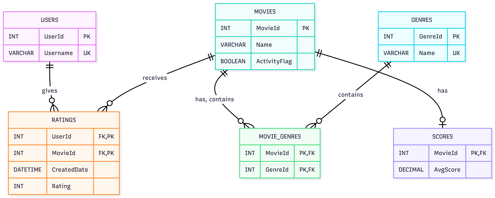

# ex603-movieTV-database
Colby Saxton

This is a Database for ex603 class for Movies/TV Shows.

This is a platform for a user to go into and create ratings for movies and view the aggregate scores for movies based on all ratings for that particular movie. This will also show a user the genre of a movie.

This will do that by creating a database schema with 5 different objects. First is a user which contains information about a user. Second is a movie. Third is a genre. Fourth is a movie genre connecting object. Fifth is a ratings object that allows a user to create a rating for a movie. See the ERD diagram below:

# Database Schema

This document describes the Schema Design for a Movie/TV user score management application.

## Tables

### `users`

Stores core user account credentials.

### `movies`

Stores information about movies.

### `genres`

Stores movie genres.

### `scores`

Stores an average score for a movie. Its primary key allows at most one score row per movie.

### `movie_genres`

Sotres the relationship between movies and genres. The composite primary key `pk_movie_genre` uses (`movie_id`, `genre_id`), preventing duplicate links between the same movie and genre.

### `ratings`

Stores individual user ratings for movies.

## Relationships

- A user can have many ratings; each rating references one user. Deleting a user cascades to their ratings.
- A movie can have many ratings; each rating references one movie. Deleting a movie cascades to its ratings.
- Movies and genres have a many-to-many relationship through `movie_genres`. Deleting a movie or genre removes the corresponding link rows.
- A movie can have at most one `scores` row because `scores.movie_id` is its primary key. Deleting the movie cascades to its score row.

## Query Catalogue

The SQL files in [`queries/`](queries/) explore ratings, movie performance, and data-quality questions.

### [`q3_1.sql`](queries/q3_1.sql)

This file contains several introductory queries:

- **Top-rated movies:** joins ratings to movies, calculates each movie's average score, and returns the ten highest averages.  
  **Business question:** Which movies have the highest average user ratings?
- **Rating statuses:** lists the distinct `rating_status` values.  
  **Business question:** What statuses can a rating have?
- **Rating filters:** returns ratings with more than 10 watch minutes, then separately returns ratings from the US or UK.  
  **Business question:** Which ratings meet these engagement and region criteria?
- **Movie title search and missing inviter values:** finds titles containing `0` and displays users with a missing `invited_by` value as `-1`.  
  **Business question:** Which titles match this search pattern, and which users have no recorded inviter?
- **Calculated columns:** assigns each movie a release-era label and converts rating scores from a 0–5 scale to a 0–100 scale.  
  **Business question:** How can movies be grouped by release era, and how do ratings compare on a 100-point scale?

### [`q3_2.sql`](queries/q3_2.sql)

- **NULL-aware country filtering:** demonstrates why `device_country != 'US'` excludes rows with a NULL country, then uses `IS NULL OR device_country != 'US'` to include them. It also shows that a SELECT alias cannot be used in the same query's `WHERE` clause and demonstrates expression and CTE alternatives.  
  **Business question:** Which ratings are from outside the US or have no recorded country, and how can country values be filtered while treating missing values as “Unknown”?

### [`q3_3.sql`](queries/q3_3.sql)

- **Users with missing rating-country data:** finds users who have a rating with a NULL `device_country`, using a subquery and two CTE-based approaches.  
  **Business question:** Which users are associated with ratings whose region was not recorded?

### [`unit4/q4_1.sql`](queries/unit4/q4_1.sql)

- **Overall rating summary:** calculates minimum, maximum, count, and sum of scores, plus the number of distinct users who rated movies.  
  **Business question:** What is the overall volume and score range of rating activity?
- **Per-movie performance:** calculates each movie's rating count and average score, ordered by rating count. A second version limits results to movies with more than nine ratings.  
  **Business question:** How much rating activity and what average score does each movie have, and which movies have enough ratings to meet the selected threshold?
- **Per-movie, per-region performance:** calculates rating counts and average scores for each movie and device country.  
  **Business question:** How do movie ratings and rating volume vary by region?

### [`unit4/q4_2.sql`](queries/unit4/q4_2.sql)

- **Per-movie failures:** counts all ratings and counts ratings whose status is not `published`.  
  **Business question:** How many rating events and non-published events does each movie have?
- **Regional totals:** uses `ROLLUP` to show rating counts by device country, including a platform-wide grand total.  
  **Business question:** How many ratings come from each region, and how many ratings are there overall?
- **Above-average rating volume:** compares each movie's rating count with the average count per movie and returns movies above that average.  
  **Business question:** Which movies attract more rating activity than the typical movie?

### [`movies.sql`](queries/movies.sql)

This is the reference dataset setup script rather than an analytical query: it recreates the database tables and loads the deterministic movie/TV dataset.  

Formatting and Mermaid ERD diagram syntax was aided by Github Copilot Free version.
